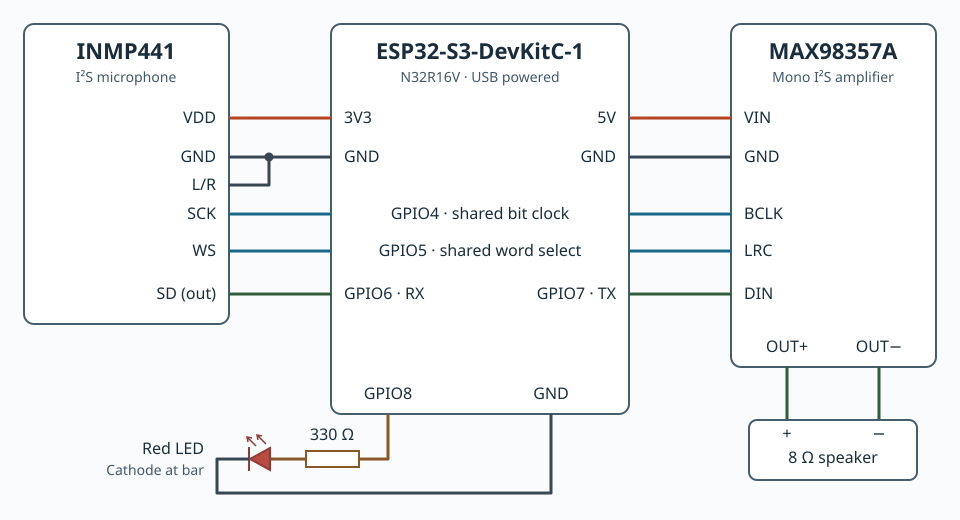

# Wire the voice-controlled lamp

This is the proposed bench wiring for the **ESP32-S3-DevKitC-1-N32R16V**,
an INMP441 microphone breakout, a MAX98357A mono amplifier breakout, an
8 Ω speaker and one red LED. The pin assignments await a hardware test.
Use the [parts list](hardware.md) to identify the modules.

## Connect the board

Unplug USB while fitting jumpers. Use the DevKit's USB port as the sole
supply. Match the **printed pin labels** on each breakout. The J1 positions
below refer to Espressif's DevKitC-1 v1.1 header. GPIO35–37 serve the
module's octal memory. [DevKitC-1 header and power options][board]

| DevKit pin | J1 position | Connect to                              |
| ---------- | ----------- | --------------------------------------- |
| 3V3        | 1 or 2      | INMP441 VDD                             |
| 5V         | 21          | MAX98357A VIN                           |
| G (GND)    | 22          | Mic GND and L/R, amp GND, LED cathode   |
| GPIO4      | 4           | Mic SCK and amp BCLK (shared bit clock) |
| GPIO5      | 5           | Mic WS and amp LRC (shared word select) |
| GPIO6      | 6           | Mic SD (data from mic to ESP)           |
| GPIO7      | 7           | Amp DIN (data from ESP to amp)          |
| GPIO8      | 12          | 330 Ω resistor in series with LED anode |

- **Microphone.** Grounding L/R selects the left audio slot. Power VDD from
  3V3. Check whether the breakout includes the datasheet's 100 kΩ pull-down
  on SD. If absent, add one between SD and GND. [INMP441 datasheet][mic]
- **Speaker.** Connect its two leads directly across the amplifier's OUT+
  and OUT− terminals. Both terminals are driven, so keep both leads
  isolated from ground. On the Adafruit #3006 breakout, leave GAIN and
  SD/MODE at their factory settings for the first test. The amplifier's
  SD/MODE controls shutdown and channel selection. [Amplifier pinout][amp]
- **Lamp.** Connect GPIO8 through the resistor to the LED anode. The
  cathode (usually the short leg, beside the flat edge) goes to the common
  ground rail. A high GPIO output lights the LED.

## Optional I2C sensor

Leave GPIO9 (J1 pin 15) and GPIO10 (J1 pin 16) free during the audio build.
A future 3.3 V I²C sensor can use GPIO9 for SDA and GPIO10 for SCL. Connect
a common ground and pull both bus lines up to 3V3. Check the sensor breakout
for fitted pull-ups before adding resistors. [ESP32-S3 I²C guide][i2c]

## First power-up

1. Connect USB and run `just run` with the ESP toolchain loaded. The current
   firmware prints its greeting and idles. [Toolchain setup][setup]
2. Once the LED driver is available, toggle GPIO8 high and low. The external
   LED should follow each transition.
3. Once playback is available, send a quiet test tone to both I²S slots.
   Listen at the speaker before trying a synthesized sentence.
4. Once capture is available, record a short phrase with the speaker silent.
   At 16 kHz with two 32-bit slots, WS is 16 kHz and BCLK is 1.024 MHz.
   Read the signed 24-bit microphone sample from the left slot and scale
   it to signed 16-bit PCM for speech recognition. [INMP441 datasheet][mic]

[board]: https://docs.espressif.com/projects/esp-dev-kits/en/latest/esp32s3/esp32-s3-devkitc-1/user_guide_v1.1.html#header-block
[mic]: https://invensense.tdk.com/wp-content/uploads/2015/02/INMP441.pdf
[amp]: https://learn.adafruit.com/adafruit-max98357-i2s-class-d-mono-amp/pinouts
[i2c]: https://docs.espressif.com/projects/esp-idf/en/stable/esp32s3/api-reference/peripherals/i2c.html
[setup]: ../README.md#install-the-tools
